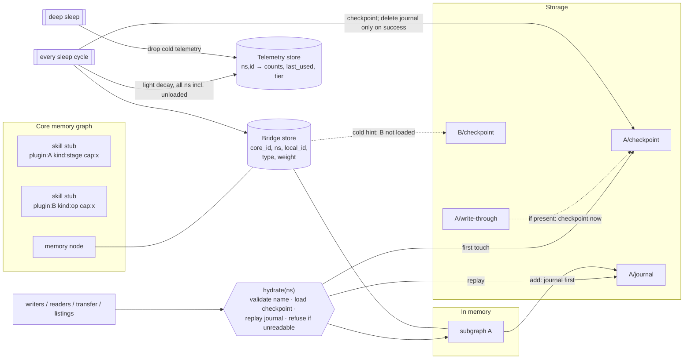

# Peripheral memory: lazily hydrated per-module subgraphs around a core memory graph, with one hydration point, per-namespace journals, out-of-band bridge edges, a persistent write-through marker and consolidation in every sleep cycle

**First public disclosure:** 2026-11-01, this document (full description). Earlier public traces: one sentence in
`THEORY.md` of [github.com/Seventhwalllab/anairyspirit](https://github.com/Seventhwalllab/anairyspirit) (2026-08-23) and
tool descriptions in the public binaries (from release v0.1.384, 2026-10-07); see [Earlier public traces](#earlier-public-traces)
**Status of disclosure:** written description with pseudocode (this document). The reference implementation is distributed
in binary form; its source code is not public
**Author:** Artem Prokhorov (Seventh Wall Lab)

Documents 01 to 10 record earlier publications. This one is the publication itself, and its date is the date this file
was first published in this repository. All times are UTC; see [README.md](README.md#how-to-verify-dates).

## What it is

A personal memory system keeps one core graph of memories. Around it sits one private subgraph ("peripheral memory") per
installed module: a plug-in, skill, tool or device. Each subgraph lives in its own storage container, named by a
whitelisted identifier, and is loaded lazily. Every reader and writer goes through one hydration function. That function
loads the container on first touch and refuses to create an empty subgraph over stored data it cannot read.

A write is recorded in a per-namespace journal before it is acknowledged. The journal is replayed idempotently on first
touch and deleted only after a successful checkpoint. A persistent marker in the namespace's directory can request a
checkpoint after every write. Links between core and peripheral nodes are kept in a separate bridge store; they survive
unloading and produce "cold" re-attach hints. Usage telemetry per peripheral pattern drives a fluency ladder. Every sleep
cycle (offline maintenance of the core graph) decays idle telemetry and checkpoints all peripheral state.

## How it works

### 0. Terms and data model

* **Core graph:** the primary graph of memory records ("engrams": nodes with content, category, tags and timestamps,
  joined by typed weighted edges). It is the agent's first-person memory.
* **Module:** any separately installed unit that extends the system, for example a pipeline stage, an operation, an
  adapter, a data-ingest sensor, a storage backend or a device driver.
* **Namespace:** the identifier of a module's peripheral memory. In the reference implementation it is the module's
  library base name with the platform prefix and suffix stripped. The same string tags the module's stub in the core graph.
* **Peripheral subgraph:** a graph with the same node and edge types as the core graph, owned by one namespace. Node
  identifiers are local to the namespace, so two namespaces may both have node 1. The core ingest pipeline does not run
  on it (no embedding, no automatic edge creation). It is a small typed store.
* **Skill stub:** one node in the core graph per installed module, with category `skill`, a tag `plugin:<name>` (the
  identity of the stub), a tag `kind:<kind>` and the module's declared capability tags.
* **Side stores:** everything persistent that belongs to peripheral memory but is not the core graph. Per namespace there
  is a checkpoint and a journal; globally there is a bridge store and a telemetry store.

```text
storage root
├── <core graph store>
├── bridge store                 (global; all core↔peripheral bridge edges)
├── telemetry store              (global; activation records keyed by (namespace, local id))
└── modules/
    └── <namespace>/             (exactly one directory per namespace, see §7)
        ├── checkpoint           (nodes + edges of the subgraph, last full save)
        ├── journal              (nodes written since that checkpoint; absent when current)
        └── write-through        (marker, present only when §5 is enabled)
```

```text
struct PeripheralState {                       // in memory, inside the engine
    subgraphs:       Map<Namespace, Graph>,    // only hydrated namespaces are present
    bridges:         Vec<BridgeEdge>,          // §3
    telemetry:       Map<(Namespace, LocalId), PatternActivation>,   // §6
    write_through:   Set<Namespace>,           // §5, mirrors on-disk markers
    hydrate_warning: Map<Namespace, Text>,     // §2, why a namespace may look emptier than it is
    side_store_read: { bridges: bool, telemetry: bool },             // §1.4
}
```

### 1. Single loading point (hydration choke point)

**1.1. One function.** Every access to a peripheral subgraph reaches it through one function, `hydrate(ns)`. This covers
writes, reads that answer a caller, transfers between namespaces, listings that need a count, and destructive whole-store
operations that need to know what they remove. The internal accessor that hands out a mutable subgraph handle calls
`hydrate(ns)` itself, so an entry point added later cannot bypass it.

```text
fn hydrate(ns) -> Result:
    validate_name(ns)?                               // §7
    if ns in subgraphs:  return Ok                   // idempotent; never discards unsaved state
    if no storage root:  return Ok                   // in-memory engine: nothing to read, nothing to lose
    match load_container(ns):                        // checkpoint, then journal replay (§2)
        Ok      -> Ok
        Err(_)  -> Err(Refusal{ ns, class: "stored subgraph cannot be read by this install",
                                remedy: "nothing was written; move it aside to accept losing it" })

fn subgraph_mut(ns) -> &mut Graph:                   // internal; every writer obtains its handle here
    hydrate(ns)                                      // loads on first touch
    return subgraphs.get_or_create(ns)

fn add(ns, content, category, tags) -> (LocalId, Option<Warning>):
    hydrate(ns)?                                     // refuse rather than shadow
    id = subgraph_mut(ns).add_node(...)
    warning = journal_append(ns, node(id)).err()     // §2
    if ns in write_through: warning |= checkpoint(ns).err()   // §5
    return (id, warning)
```

**1.2. Refusal instead of shadowing.** The choke point exists to prevent lazy creation. Suppose a writer creates an empty
in-memory subgraph for a namespace whose container exists on storage but has not been read. The next checkpoint then
writes "empty plus one record" over the stored data. So a write into a namespace whose stored container cannot be read
fails. The refusal names the namespace, the class of failure and the remedy, and nothing is written.

**1.3. "Not counted" is not "zero".** A listing of namespaces is the union of the namespaces in memory and the namespace
directories on storage that hold a checkpoint or a journal. If a namespace is on storage and this process has not
hydrated it yet, its count is reported as unknown (`null`), not 0. A client therefore cannot mistake unread memory for
erased memory. Reads that answer with content hydrate first.

**1.4. Global side stores: never overwrite what this process did not read.** The bridge store and the telemetry store are
loaded once at start-up. Each loader sets a per-store `read` flag. The flag is also set when the store is absent (nothing
to lose) and after every successful write. A writer refuses to replace a store that exists on storage while its flag is
unset. Both global stores are loaded before any operation that could trigger a sleep cycle, such as writing skill stubs
at start-up, because a sleep cycle checkpoints them (§6).

**1.5. Lifecycle hooks.** Attaching a module calls `hydrate(ns)`. Detaching it checkpoints the subgraph and drops it
from memory ("flush and drop"). A clean shutdown checkpoints all peripheral state explicitly, alongside the core graph,
and does so even on paths where destructors do not run.

### 2. Per-namespace journal

**2.1. Write path.** Before `add` answers, the new node is recorded in the namespace's journal together with the local
identifier it was given. In the reference implementation the journal is a small file holding the list of all nodes
written since the last checkpoint. Each append reads that list, adds the node, writes a temporary sibling file and
renames it over the journal. The journal is handled exactly like the namespace's checkpoint (§4). If the append fails,
the node stays in memory and the answer carries a warning that an unclean stop would lose it.

**2.2. Replay on first touch.** `load_container(ns)` reads the checkpoint, if there is one, into a fresh subgraph and
inserts nodes with their stored identifiers. It then replays the journal. A journal record whose identifier is already
present is skipped; any other record is restored with its identifier. Replaying twice, or replaying a journal that partly
overlaps the checkpoint, gives the same subgraph. A namespace whose only file is a journal (an unclean stop before its
first checkpoint) is still a namespace: listings include it, and hydration rebuilds it from the journal alone.

**2.3. Clear only after success.** `checkpoint(ns)` writes the full subgraph. The journal is deleted only if that write
returns success. When a checkpoint is refused, for example under §1.4 or because the stored file cannot be read by this
install, the journal stays in place and nothing it holds is dropped.

**2.4. Unreadable journal.** If the journal cannot be read or decoded, it is skipped and the subgraph is what the last
checkpoint held. The namespace gets a `hydrate_warning` entry, and every listing attaches it to its answer: "records
written since the last checkpoint are not in this answer; the checkpoint is intact; nothing was deleted". Hydration
itself does not fail, because reads must still answer.

**2.5. Membership in whole-store operations.** The journal is a side store in the sense of §4.2. Backup, restore,
migration and wipe handle a namespace's checkpoint and journal as a pair, since the journal holds exactly the records the
checkpoint lacks.

### 3. Bridges between the core and the periphery

**3.1. Separate store.** A bridge edge is a record

```text
struct BridgeEdge {
    core_id:   CoreNodeId,       // endpoint in the core graph
    namespace: Namespace,        // which peripheral subgraph
    local_id:  LocalId,          // endpoint inside that subgraph
    edge_type: EdgeType,         // same relation vocabulary as ordinary edges
    weight:    f32,              // same semantics as ordinary edges
}
```

kept in one global list beside the engine. It is not a field on the ordinary edge type and it is not stored inside
either graph. The ordinary edge type, which every traversal and serialisation reads, has no optional namespace field,
and local peripheral identifiers never reach core traversal.

**3.2. Insertion check.** When a bridge is inserted, the engine checks that the core node exists, that the namespace is
hydrated and that the local node exists in it. The target namespace may be unloaded afterwards; the bridge stays.

**3.3. Queries.** Three queries cover both directions:

* `bridges_from_core(core_id)`: all bridges leaving a core node;
* `bridges_to(namespace, local_id)`: the core nodes that reference a peripheral node;
* `cold_bridges_from_core(core_id)`: bridges whose target namespace is not in memory at the moment. They are returned as
  hints ("this memory links into module X, which is not loaded; re-attach?") and the target is not loaded.

**3.4. Persistence.** The bridge list is saved as one global side store at every peripheral checkpoint (§6) and is loaded
at start-up under the rule of §1.4. In the reference implementation bridges are an engine-level facility; no public
command creates them yet.

### 4. Side stores: binding and enumeration

**4.1. Binding.** Side stores are bound to the graph's key.

**4.2. One enumerator.** A single function lists every side store. It sits at the lowest layer of the software, so every
caller can reach it. It returns the fixed-name global stores and, by scanning the module directory, the checkpoint and
journal of each namespace (namespaces are not known in advance). Backup, restore/import, migration into a new store and
wipe all iterate this one list whenever they copy, replace, clear or remove the core graph. A new kind of side store is
added by changing that one function.

**4.3. Content, not bytes.** When side stores move to a different core graph, for example in a migration that creates a
new one, they are read through the engine that holds the source graph and then written through the engine that holds
the target graph. These are two separate steps, because the source is closed before the target is opened. Side stores
are never copied as raw bytes.

**4.4. All or nothing.** An operation that rewrites every side store opens all of them before it writes any. A failure
therefore leaves none of them rewritten instead of some.

### 5. Persistent "write through" marker

**5.1. Policy.** By default a peripheral write reaches durable storage through the journal (§2) and the next checkpoint
(sleep, detach or shutdown). Some namespaces cannot accept that window between memory and a full checkpoint. For them a
per-namespace flag requests a full checkpoint of the namespace immediately after every `add`.

**5.2. Stored with the namespace.** The flag is persisted as a marker file inside the namespace's own directory, not in
the operator's configuration file. It is a property of the namespace: it is created and destroyed with the namespace, and
setting it never rewrites operator configuration. At start-up the engine scans the module directories and sets the flag
for each namespace that has a marker, on every start-up path. Wiping peripheral memory removes the markers along with the
data.

**5.3. Honest results.** Setting or clearing the flag updates memory first and the marker second. If the marker cannot be
written or removed, the call returns an error saying the change will not survive a restart. If an immediate checkpoint
fails, the record stays in memory and in the journal, and the answer to the write carries the warning "in memory and
searchable now; not on disk yet" instead of plain success.

### 6. Consolidation in every sleep cycle

**6.1. Composition.** The system has an offline maintenance routine ("sleep") for the core graph. It runs in a default
mode, in an automatic mode triggered after a configured number of core writes, in a light mode and in a deep mode. The
light and deep modes call the base routine. Peripheral maintenance is attached to the base routine, after the core work,
so every sleep that is not a dry run performs it, whatever the mode:

```text
fn sleep_base():
    …core maintenance…
    reports  = for ns in consolidation_set(): light_consolidate(ns, idle = 30 days)
    refusals = checkpoint_all_peripheral_state()   // subgraphs in memory (+ clear their journals),
                                                   // bridge store, telemetry store
    return SleepResult{ …, peripheral_reports: reports,
                        checkpoint_refusals: refusals  /* present only when non-empty */ }

fn consolidation_set() = namespaces_in_memory ∪ { r.namespace for r in telemetry }
```

Telemetry lives in a global store keyed by `(namespace, local_id)`. Namespaces that are not loaded are therefore
consolidated as well, and their subgraphs are not hydrated for it.

**6.2. Telemetry and fluency ladder.**

```text
struct PatternActivation {
    namespace, local_id,
    activation_count: u64,     // successful uses
    override_count:   u64,     // corrections
    last_used:        unix seconds (0 = never),
    fluency:          Candidate | Active | Fluent,
}
net = activation_count − override_count
tier(net) = Fluent if net ≥ 20, Active if net ≥ 5, else Candidate
on activation: activation_count += 1; last_used = now; fluency = tier(net)
on override:   override_count += 1;  fluency = one tier down (Candidate is the floor)
```

Telemetry is kept outside the peripheral node, so the stored pattern carries no training state.

**6.3. Light pass (every sleep).**

```text
fn light_consolidate(ns, idle):
    for r in telemetry where r.namespace == ns:
        if r.last_used == 0: continue                  // never used: left alone
        if now − r.last_used ≤ idle: continue
        r.activation_count = saturating(r.activation_count − 1)
        r.fluency = min(tier(net(r)), r.fluency)       // decay may only lower a tier, never raise it
```

The decrement happens once per pass, so the decay rate follows the sleep cadence. Decay does not reset the last-use time.

**6.4. Deep pass (every deep sleep).** After the light pass that deep sleep runs through the base routine, the deep pass
visits every namespace in the consolidation set. It removes telemetry records with `activation_count == 0`,
`last_used > 0` and an idle time above a deep threshold of about 180 days. The peripheral node itself stays. Only its
training history is forgotten, and the pattern returns to an unstudied state. A dry run performs neither pass.

**6.5. Reporting.** Each pass returns per-namespace counts of records examined, decayed and demoted. Checkpoint refusals
(§1.4, §2.3) are returned in the sleep result instead of being swallowed.

### 7. Whitelist of namespace names

A namespace names one module and becomes exactly one directory under the module directory. Its identity rule is
therefore a whitelist, applied before any use (hydration, reads, the marker of §5):

```text
fn validate_name(ns):
    refuse if ns is empty
    refuse if ns starts with "."
    refuse if len(ns) > 128
    refuse if any char ∉ [A-Z a-z 0-9 _ - .]
```

A name outside the alphabet is refused. It is not normalised or escaped, so one name maps to one container and one
container to one name. The refusal text states the allowed alphabet, since that is the part a caller can act on.

### 8. Surrounding mechanisms (context)

* **Skill stubs and capability index.** On start-up the system reconciles the skill stubs in the core graph with the
  installed-module manifest. Missing stubs are added, stubs with changed text are updated, unchanged ones are skipped.
  Identity is the `plugin:` tag, not text similarity. A capability index maps each declared capability tag to the modules
  that declare it. Discovery answers combine the manifest (installed) and the graph (attached) and mark which is which.
* **Transfer between modules.** A peripheral node can be copied into another namespace. Content, category and tags are
  copied and a provenance tag `seeded_from:<source_ns>:<source_id>` is added. Telemetry is not copied; the copy starts as
  Candidate. The copy is written through `add` (§1) and is therefore journalled.
* **Use of the tier.** A module may use the tier to choose how readily it surfaces a pattern (Candidate: tried; Active:
  reliable; Fluent: well practised). In the reference implementation the tier is reported to the agent and to the
  operator.

### Figure 1



## Earlier public traces

Two parts of peripheral memory were public before this document:

| Date (UTC) | Where | What was public | Evidence |
|---|---|---|---|
| 2026-08-23 | [`THEORY.md`](https://github.com/Seventhwalllab/anairyspirit/blob/main/THEORY.md), section "What is ours", repository Seventhwalllab/anairyspirit | the sentence "Peripheral memory as separate subgraphs." | commit [`78ff8886`](https://github.com/Seventhwalllab/anairyspirit/commit/78ff8886fd1f14326805693086bf8223f98a7bb3) (pushed as [`cd61082e`](https://github.com/Seventhwalllab/anairyspirit/commit/cd61082ef8359887f1bb6efed71a37654ff43e4c)); push 17:27:54Z ([activity](https://github.com/Seventhwalllab/anairyspirit/activity)). The history of `main` was rewritten on 2026-10-10; both hashes carry the sentence |
| 2026-10-07 | public binaries of release [v0.1.384](https://github.com/Seventhwalllab/anairyspirit/releases/tag/v0.1.384) | the MCP tool descriptions, which the program returns to every client (`tools/list`): writes go into a module's subgraph "rather than the core graph"; a peripheral count is `null` while the module's memory sits on disk unread since start-up; the fluency ladder (Candidate → Active at 5 net activations → Fluent at 20); a correction demotes one tier, with Candidate as the floor; transfer adds the `seeded_from:<source_ns>:<source_id>` tag and starts the copy with fresh Candidate telemetry; light decay of patterns idle longer than 30 days; deep removal of fully cold telemetry after 180 days, with the pattern kept; the capability index | release published 2026-10-07T11:58:05Z |

The rest is disclosed here for the first time:

* the single hydration point on every read and write path, and the refusal to shadow unread data (§1.1, §1.2);
* `null` counts for journal-only and unread namespaces (§1.3);
* the rule that a global side store is replaced only if this process read it (§1.4);
* the per-namespace journal and its clear-after-checkpoint order (§2);
* bridge edges in a separate store, with cold hints (§3);
* the binding and single enumeration of side stores (§4);
* the persistent write-through marker (§5);
* peripheral consolidation inside every sleep cycle, unloaded namespaces included (§6.1);
* the namespace whitelist as an identity rule (§7).

## Variants and generalizations

Each element below may be used alone or combined with any of the others.

**Units.** "Module" and "skill" are examples. The partition key may be a plug-in, tool, skill, device, sensor, model,
agent, sub-agent, user, tenant, project, repository, conversation, session, document collection, topic, a community
detected in the graph, a time period or any other key. Partitions may be nested (namespaces of namespaces). The
peripheral unit may be a subgraph, a table, a vector index, a key-value map, a document set or a model checkpoint. The
core may itself be one partition among several, and there may be several cores.

**Storage media.** Directories and files are one embodiment. Others: one table or schema per namespace in a relational or
embedded database; key prefixes in a key-value store; buckets or prefixes in an object store; named graphs in a triple
store; collections in a document or vector database; browser storage (IndexedDB) or mobile app storage; containers in a
single archive file; remote services addressed by namespace. A "marker file" may equally be a row, an attribute, an
extended file attribute, a flag in the namespace's own header or manifest, or a record in a namespace-local metadata
store.

**Loading triggers.** First touch is one trigger. Others are attaching or enabling the module, a query whose routing
points at the namespace (by capability tag, bridge edge, classifier or skill-stub hit), prediction of need (prefetch), a
schedule and a user command. Unloading may follow detaching, memory pressure, least-recently-used eviction, an idle
timeout or the end of a session. The choke point may be a function, a proxy object, a storage driver, a middleware layer
or a database view. The refusal may take the form of an error, an exception, a status code, a read-only mode or a
quarantine of the namespace.

**Journal forms.** An append-only log; one file per record; a log of operations including updates and deletions; a shared
journal with a namespace field; a database transaction log; replicated logs. Replay may be keyed by identifier, sequence
number or content hash. "Delete after checkpoint" includes truncation, rotation and marking records as applied.

**Bridges.** A bridge may connect two peripheral subgraphs, connect a peripheral subgraph to several cores, or be a
hyperedge. Bridges may be stored in any structure outside the primary edge set (a separate file, table, index or service).
They may carry direction, confidence, provenance or expiry. They may be created by an agent, by the module or from
similarity. The cold hint may drive a prompt, an automatic re-attach or a ranking signal.

**Side-store binding.** Any arrangement in which the auxiliary stores of a primary store are bound to that store and move
only through it; any single registry of auxiliary stores that all whole-store operations consult; any move between
stores done by reading through the source and writing through the target.

**Durability policy.** The per-namespace setting may be a level instead of a boolean (journal only, checkpoint every N
writes, synchronous flush, replicated write), a time bound, or a policy the module chooses at installation. It may be
persisted in any namespace-local place.

**Consolidation triggers.** "Sleep" stands for any offline, idle, scheduled or batch maintenance phase: after N writes,
on a timer, when idle, when charging, on shutdown, on start-up, on detach or on user request. The light and deep passes
may run in the same phase or in different ones. Decay may be a fixed decrement per pass, exponential or power-law decay
in elapsed time, or decay of a continuous score. Thresholds may be set per module or per pattern, or learned from data.
The deep pass may archive records instead of deleting them.

**Tiers.** Any number of tiers, or a continuous fluency score. Promotion may use net successes, a success ratio,
recency-weighted counts or an external evaluation. A correction may demote by one tier or by several. Tiers may gate
ranking, display or transfer.

**Names.** Any whitelist or canonical encoding that guarantees a one-to-one mapping between namespace and container, for
example a restricted alphabet, numeric identifiers, name hashes with a separate name table, or percent-encoding with a
uniqueness check.

## Advantages

* The core graph stays small. Module memory costs nothing until it is used and can be unloaded again.
* Failure domains are isolated. An unreadable module store does not block the core or other modules, and a write into it
  is refused instead of replacing it with an empty one.
* With only one loading point, no entry point can write before loading.
* Peripheral writes survive a crash without a core write-ahead log, and a refused checkpoint never loses the journal.
* The ordinary edge type and all core traversals are unchanged. Links into unloaded modules stay visible as hints.
* Durability can be raised for one namespace without a global cost, and the setting survives restarts.
* Module telemetry is maintained by the existing sleep cycle, unloaded modules included, so no separate scheduler is
  needed.
* Backup, restore, migration and wipe take all side stores from one list.

## Prior work and our contribution

Builds on: separate named graphs in one store (Carroll, Bizer, Hayes & Stickler, *Named graphs, provenance and trust*,
WWW 2005); logging before acknowledgement, replay and checkpoints (ARIES, Mohan et al., ACM TODS 17(1), 1992); lazy
loading and eviction of partitions; tiers of agent memory with paging between context and archive (MemGPT, arXiv
2310.08560, 2023); a long-term memory store for agents organised in custom namespaces with put, get and search (LangGraph
long-term memory, LangChain, 2024-10-08); extracted-fact memory for agents (Mem0, arXiv 2504.19413, 2025); offline
"sleep-time" computation for agents (arXiv 2504.13171, 2025); a skill library for an agent (Voyager, arXiv 2305.16291,
2023); a task-agnostic memory module plugged into an arbitrary agent and organised as a knowledge graph (PlugMem, arXiv
2603.03296, 2026); skill libraries whose entries are admitted, repaired or pruned and shared with provenance and rollback
(Dynamic Agent Skills survey, arXiv 2607.10113, 2026-07-11); skill lifecycle as an evidence-gated state-transition process
(TrackRL, arXiv 2610.25126, 2026-10-18); promotion to a higher group on success and demotion on failure down to a floor
group (the flashcard scheme of US 8,832,117 B2, Su, filed 2012-02-06, which relates it to Leitner's method; Leitner,
*So lernt man lernen*, Herder, 1972); three stages of skill acquisition, cognitive, associative and autonomous (Fitts,
1964; Fitts & Posner, *Human Performance*, 1967; as described in Anderson, *Acquisition of cognitive skill*, *Psychological
Review* 89(4), 369-406, 1982); availability of a memory tied to the frequency and recency of its use (Anderson &
Schooler, *Psychological Science* 2(6), 1991), formalised as the base-level learning equation of ACT-R, B = ln(sum of
t_j^-d) over past uses (Taatgen, Lebiere & Anderson, *Modeling paradigms in ACT-R*, in R. Sun (ed.), *Cognition and
Multi-Agent Interaction*, Cambridge University Press, 2006, pp. 29-52); offline consolidation between memory systems (McClelland, McNaughton &
O'Reilly, *Psychological Review* 102(3), 1995); a hierarchical multi-layer action store whose mappings are created and
updated from execution feedback and performance signals (US 12,681,858 B2, Microsoft, priority 2024-10-21, granted
2026-07-14). Predecessor: hippograph-pro stored ingested skills as ordinary `skill` nodes of its single graph
([`b67c2a6`](https://github.com/artemMprokhorov/hippograph-pro/commit/b67c2a6f9bbac56785e39e8273934ed789940037), pushed as
[`7993e70`](https://github.com/artemMprokhorov/hippograph-pro/commit/7993e7043d1edbab228cb2fcb6b141a991c89203), 2026-03-05);
it had no peripheral subgraphs.
Our contribution (first disclosed in full: 2026-11-01): a core memory graph whose installed modules each own a
private, lazily hydrated subgraph. One hydration function sits on every read and write path; it refuses instead of
shadowing when stored data cannot be read, and reports unread namespaces as unknown, not zero. A per-namespace journal is
tied to that function, replayed idempotently and cleared only after a successful checkpoint. Global side stores are
never replaced unless this process read them. Bridge edges are kept outside both the core and the module edge sets,
survive the unloading of their target and are returned as cold re-attach hints. Side stores are bound to the core graph,
and every whole-store operation takes them from one enumeration. The durability policy is a marker inside the
namespace's own container. Module telemetry (net successes, one-tier demotion on correction, a floor tier) is decayed and
checkpointed in every core sleep cycle, for unloaded modules as well. A whitelist makes the namespace name and its
storage container one and the same thing.

What the nearest references lack relative to this description:

| Reference | What it has | What it lacks |
|---|---|---|
| Named graphs (2005) | Separate graphs in one store | Single hydration point with refusal; journal; bridge store; telemetry |
| ARIES (1992) and write-ahead logging practice | Logging before acknowledgement, replay, checkpoint | A per-namespace journal coupled to lazy hydration and to sleep checkpoints |
| MemGPT (2023); LangGraph long-term memory (2024) | Memory tiers with paging; a namespaced memory store | Per-module subgraphs beside a core graph; bridges; fluency ladder |
| Voyager (2023) | Library of skills for an agent | A persistent subgraph per skill; telemetry decay in sleep |
| Dynamic Agent Skills (2026); TrackRL (2026) | Lifecycle of agent skills: admission, repair, pruning, provenance, rollback; evidence-gated state transitions | Per-module subgraphs; lazy hydration; idle decay in a sleep phase |
| PlugMem (2026) | A memory module attached to an agent | A memory per installed module; the storage mechanisms of §1 to §7 |
| US 8,832,117 B2 (Leitner's method) | Promotion on success, demotion on failure, floor group | Subgraphs per module; lazy hydration; sleep-phase decay; transfer with provenance |
| Fitts (1964), Fitts & Posner (1967); Anderson & Schooler (1991), ACT-R base-level learning; McClelland et al. (1995) | Availability by recency and frequency of use; offline consolidation | Per-module subgraphs, journals, bridges; a tier ladder |
| US 12,681,858 B2 | Hierarchical action store with memory layers, updated by execution signals | Tier ladder; per-module subgraph lifecycle; bridges; journal |

## Reference implementation

Reference implementation: An Airy Spirit (github.com/Seventhwalllab/anairyspirit), versions 0.1.301 to 0.1.440. The
engine is distributed in binary form; its source code is not public. The single hydration point of §1 is present from
0.1.301, and every element described here is present from 0.1.416.

## Citation

Prokhorov, Artem. *Peripheral memory: lazily hydrated per-module subgraphs around a core memory graph*. Prior public
disclosures, document 11. GitHub, https://github.com/Seventhwalllab/prior-disclosures/blob/main/11-peripheral-memory.md
(2026-11-01). CC BY 4.0. Reference implementation: An Airy Spirit, https://github.com/Seventhwalllab/anairyspirit.
